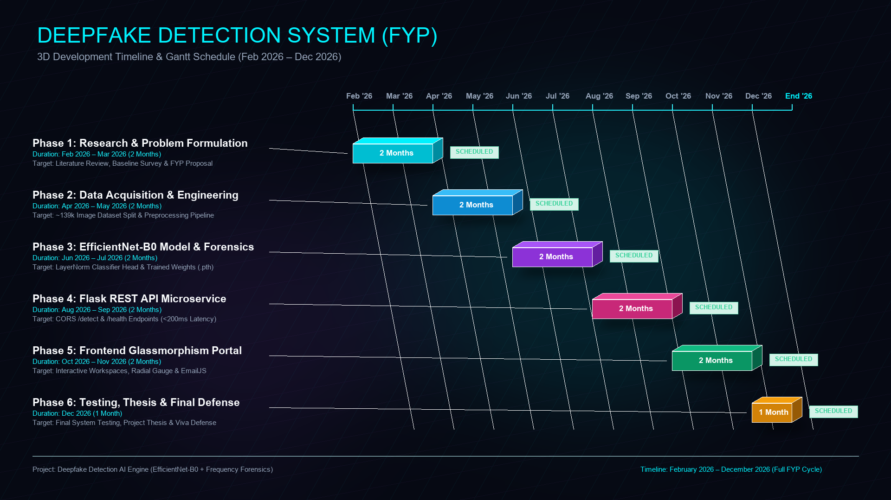
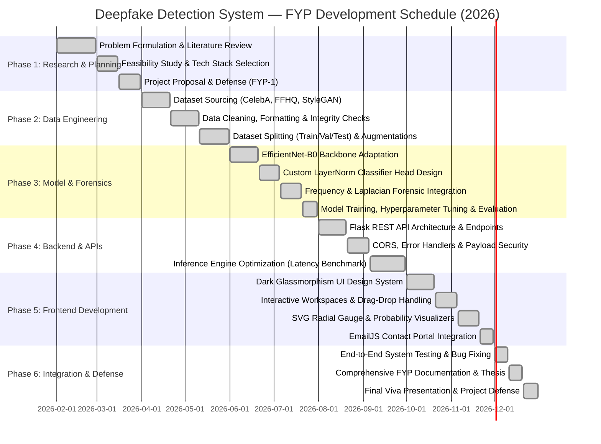

# Deepfake Detection System Using Deep Learning
### Final Year Project (FYP) — Comprehensive System Documentation

---

## 1. Project Overview & Abstract

In recent years, generative AI models such as StyleGAN, Stable Diffusion, and deep face-swapping algorithms have advanced to the point where creating ultra-realistic synthetic human faces takes seconds. These deepfakes are increasingly exploited for identity theft, social engineering, disinformation, and digital impersonation. Because modern generative tools accurately replicate skin textures, lighting, and facial geometry, detecting manipulations with the human eye is virtually impossible.

This project delivers an end-to-end, real-time **Deepfake Detection System**. It combines a fine-tuned **EfficientNet-B0 Convolutional Neural Network (CNN)** with **frequency-domain forensic cues** (Laplacian variance and 2D FFT spectral analysis) to classify facial images as **Authentic (Real)** or **Manipulated (Fake)**.

The system is split into two integrated layers:
1. **Frontend (FE):** A responsive, glassmorphism web portal with real-time drag-and-drop uploads, simulated neural scanning progress visualizers, dynamic SVG radial confidence meters, probability comparison bars, and EmailJS-powered team communication.
2. **Backend (BE):** A Python/Flask microservice running a PyTorch inference engine with custom classifier architecture, hardware acceleration (GPU CUDA / CPU fallback), automated dataset loaders, and complete training pipelines.

---

## 2. Technology Stack

| Layer | Technologies & Libraries | Purpose |
| :--- | :--- | :--- |
| **Frontend Core** | HTML5, Modern CSS3 (Vanilla), JavaScript (ES6+) | User interface, layout, animations, client-side controller |
| **Frontend Styling** | Custom CSS Variables, Glassmorphism, Keyframe Animations | Dark cyberpunk/forensic aesthetic, visual polish |
| **UI Components** | Lucide Icons, Google Fonts (Orbitron, Space Grotesk, Outfit) | Modern typography and iconography |
| **Client Services** | EmailJS Browser SDK v4 | Contact form messaging directly to project team |
| **Backend Core** | Python 3.10+, Flask, Flask-CORS, Werkzeug | REST API, CORS handling, file validation, routing |
| **Deep Learning** | PyTorch, Torchvision | EfficientNet-B0 model backbone, LayerNorm head, inference |
| **Computer Vision** | OpenCV (`cv2`), Pillow (PIL), NumPy | Image decoding, resizing, Laplacian filtering, 2D FFT analysis |
| **Training Pipeline** | PyTorch `DataLoader`, AdamW, Cosine Annealing, `tqdm` | Dataset batching, data augmentation, model training & checkpointing |

---

## 3. End-to-End System Architecture & Data Flow

```
[User Browser (Frontend)]
       │
       ├─► 1. User selects or drops an image (.jpg, .png, .webp)
       ├─► 2. Client-side validation & FileReader image preview
       ├─► 3. User clicks "Start AI Analysis"
       │      ├─► Starts multi-stage visual scanning animation
       │      └─► Sends HTTP POST multipart/form-data to Flask backend
       │
[Flask REST API Server (Backend :5000)]
       │
       ├─► 4. Validates request, file extension, and upload size (<32MB)
       ├─► 5. PIL byte verification to prevent corrupted image crashes
       ├─► 6. Preprocessing: Resized to 224x224 & normalized with ImageNet stats
       ├─► 7. Deep Learning Inference:
       │      ├─► Passes tensor through EfficientNet-B0 + LayerNorm head
       │      └─► Calculates forensic cues (Laplacian sharpness + FFT spectral ratio)
       ├─► 8. Calibrates confidence score & calculates real/fake probabilities
       │
       └─► 9. Returns JSON response to Frontend
              │
[Frontend UI Update]
       │
       ├─► 10. Stops scanning animations
       ├─► 11. Animates SVG radial confidence gauge (0% → Final %)
       ├─► 12. Animates probability comparison bars (Real vs. Fake)
       └─► 13. Populates dynamic diagnostic forensic report
```

---

## 4. Frontend (FE) Deep-Dive

The frontend is designed around a dark, glassmorphism theme (`style.css`) providing a cybersecurity / AI forensic workspace feel.

### 4.1. Pages Breakdown

* **`index.html` (Main Single-Page Application):**
  * Serves as the primary landing and all-in-one portal.
  * Contains the Hero Section, interactive AI detection dropzone, instant preview card, dynamic results section, "How It Works" overview, and Contact form.
* **`workspace.html` & `detect-image.html` (Dedicated Workspaces):**
  * Focused, distraction-free workspaces containing only the detection tool, scanner preview, progress logs, radial gauge, and probability charts.
* **`home.html`:**
  * Clean presentation landing page highlighting project features, detection accuracy metrics, and quick navigation links.
* **`how-it-works.html`:**
  * Visual walkthrough of the 4-stage pipeline: (1) Image Ingestion, (2) Face Alignment & Resizing, (3) Frequency & Spatial CNN Inference, (4) Forensic Report Generation.
* **`about.html`:**
  * Detailed background on deepfake proliferation, generative adversarial networks (GANs), dataset architecture, model benchmarks, and team credits.
* **`faq.html`:**
  * Interactive accordion addressing common questions (supported formats, inference speed, model accuracy, false positives, privacy).
* **`contact.html`:**
  * Standalone contact page allowing users to send inquiries directly to the project team.

### 4.2. Frontend Controller & Logic (`script.js`)

* **Drag-and-Drop & File Preview:**
  * Listens for `dragenter`, `dragover`, `dragleave`, and `drop` events on `#uploadArea`.
  * Automatically validates file types and uses `FileReader.readAsDataURL()` to display the image in `#preview-img` before sending it to the server.
* **Multi-Stage AI Progress Simulation (`simulateAIScanSteps`):**
  * Runs concurrently with the network request using `Promise.all()`.
  * Progressively lights up forensic step logs (Geometric alignment $\to$ High-frequency analysis $\to$ EfficientNet inference $\to$ Report compilation) with progress bar animations.
* **Dynamic Radial Confidence Gauge (`renderResults`):**
  * Uses SVG circle stroke manipulation:
    $$\text{offset} = \text{circumference} - \left(\frac{\text{confidence}}{100} \times \text{circumference}\right)$$
  * Smoothly interpolates the numerical counter from $0\%$ to the final confidence score.
* **Class Probability Bars:**
  * Dynamically animates the width of `#barRealFill` and `#barFakeFill` along with color transitions (cyan/green for Authentic, crimson/red for Manipulated).
* **Diagnostic Report Generator:**
  * Dynamically generates forensic diagnostic observations in `#diagnosticList` (e.g. natural skin grain variance, corneal reflections, convolutional boundary anomalies).
* **EmailJS Integration (`setupContactForm`):**
  * Intercepts `#contactForm` submit events.
  * Uses EmailJS SDK v4 to dispatch formatted inquiry emails to the team email addresses (`hafizasasa1234@gmail.com` and `alimarjansgdpk@gmail.com`) without requiring a separate backend mail server.

---

## 5. Backend (BE) Deep-Dive

The backend is built as a modular Python service structured for clean separation of concerns between web routing, inference, and training.

### 5.1. File Structure & Responsibilities

```text
backend/
├── DF-DATASET/                    # Dataset directory
│   ├── Cleaned/                   # Verified, deduplicated, 50/50 balanced dataset (144,652 images)
│   │   ├── Real/                  # 72,326 authentic images (RCA: 36,228 | RFF: 36,098)
│   │   └── Fake/                  # 72,326 synthetic images (FSG: 61,667 | FSD: 9,971 | AI: 688)
│   ├── splits/                    # Reproducible 70/15/15 stratified split manifests (seed=42)
│   │   ├── train.csv              # 101,256 samples (50,628 Real / 50,628 Fake)
│   │   ├── val.csv                # 21,698 samples (10,849 Real / 10,849 Fake)
│   │   └── test.csv               # 21,698 samples (10,849 Real / 10,849 Fake)
│   └── create_splits.py           # Stratified split generator script
│
├── model/
│   ├── deepfake_detector.pth      # Production PyTorch model weights checkpoint (52.5 MB)
│   └── experiments/               # Experimental training checkpoints (best/last .pth)
│
├── app.py                         # Flask REST API server and route handlers
├── config.py                      # Global configuration, paths, and device setup
├── detector.py                    # Inference engine & frequency domain analysis
├── model_architecture.py          # PyTorch EfficientNet-B0 + LayerNorm classifier
├── train.py                       # Dataset loader, training/val/test loops, metrics & checkpointing
├── run.py                         # Clean server startup script
├── start_server.bat               # Windows batch script to launch the API server
├── train_model.bat                # Windows batch script to trigger model training
└── requirements.txt               # Python package dependencies
```

### 5.2. Flask REST API (`app.py`)

* **CORS Enabled:** Configured via `flask-cors` so any frontend port (or local `file://` / `http://localhost:3000`) can communicate seamlessly.
* **Max Payload:** Limited to 32MB via `app.config["MAX_CONTENT_LENGTH"]` to prevent memory flooding.
* **Endpoints:**
  * `GET /`: Serves the Frontend UI (`Frontend/index.html` and static assets) directly on port `5000`.
  * `POST /detect`: Accepts multipart form data with the `image` field, validates the extension, reads the raw byte stream, and passes it to the detector singleton.
  * `GET /health`: Returns JSON health status, active compute device (`cpu` or `cuda`), model loaded flag, and dataset presence.
  * `GET /api/status`: Basic JSON service discovery and API status check.
* **Global Error Handlers:** Catches 400 (bad input), 404 (route missing), 413 (payload too large), and 500 (internal error) returning JSON error objects instead of HTML error pages.

### 5.3. Deepfake Detection Engine (`detector.py`)

* **Singleton Pattern (`get_detector()`):** Instantiates the neural model only once on server startup, keeping weights in memory for fast sub-second inference.
* **Image Integrity Validation (`validate_image`):** Uses PIL's `verify()` method to detect corrupted, truncated, or malicious non-image files before passing them to PyTorch tensors.
* **Forensic Cue Extraction (`_extract_forensic_cues`):**
  * **Laplacian Variance:** Computes $\text{Var}(\nabla^2 I)$ over grayscale pixels to measure sharpness inconsistency and high-frequency edge distribution.
  * **2D Fast Fourier Transform (FFT):** Calculates the 2D power spectrum $S(u, v) = 20 \log(|F(u, v)| + \epsilon)$, masks the low-frequency center, and computes the high-to-low frequency spectral energy ratio.

### 5.4. Neural Network Architecture (`model_architecture.py`)

```
Input Image Tensor (3, 224, 224)
       │
       ▼
EfficientNet-B0 Backbone (Pretrained Features Extractor)
       │
       ▼
Adaptive Average Pooling (1280 Features)
       │
       ▼
Custom Forensic Classifier Head:
  ├─► Dropout (p = 0.40)
  ├─► Linear (1280 → 256)
  ├─► LayerNorm (256)           <-- Stabilizes batch_size=1 web inference
  ├─► SiLU Activation
  ├─► Dropout (p = 0.20)
  └─► Linear (256 → 2)          <-- Output: [Logit_Real, Logit_Fake]
       │
       ▼
Softmax Probability Distribution
```

#### Why LayerNorm instead of BatchNorm?
In typical CNN architectures, Batch Normalization is used. However, during real-world single-image web inference (`batch_size = 1`), BatchNorm depends on running mean/variance statistics that can produce unstable outputs if the input image's distribution differs slightly from the training batch. 

**LayerNorm** normalizes across feature dimensions for each individual sample, ensuring stable, reliable inference regardless of batch size.

### 5.5. Dataset, Quality Audit & Preprocessing Pipeline (`create_splits.py` & `train.py`)

* **Cleaned & Balanced Dataset (`DF-DATASET/Cleaned`):**
  * **Total Verified Images:** **144,652** ($4.39\text{ GB}$, all $299 \times 299$, $0$ corrupted, $0$ zero-byte, $0$ duplicates).
  * **Exact 50/50 Class Balance:** **72,326 Real** (Class 0: `RCA` CelebA = $36,228$, `RFF` FFHQ = $36,098$) and **72,326 Fake** (Class 1: `FSG` StyleGAN = $61,667$, `FSD` Stable Diffusion = $9,971$, `AI` = $688$).
  * **Quality Curation:** SHA-256 deduplication removed $8,336$ exact duplicates, and targeted template-matching removed $313$ `pollinations.ai` watermarked Fake images prior to 50/50 class balancing (`seed = 42`).
* **Dataset Quality & Bias Audit Findings (at $224 \times 224$):**
  * **Macro-Sharpness, Brightness & Color:** Well-matched across classes — Sobel Sharpness ($\text{Real med} = 52.01$, $\text{Fake med} = 52.26$, $\text{AUC} = 0.5109$), Brightness ($\text{Real med} = 112.53$, $\text{Fake med} = 115.47$, $\text{AUC} = 0.5226$), Contrast ($\text{AUC} = 0.5790$), and Color Saturation ($\text{AUC} = 0.5368$).
  * **Sub-Source Blur & Grayscale Biases Identified & Mitigated:**
    1. *Blur Asymmetry ($\text{AUC} = 0.6391$):* While `RFF` Real ($\text{med} = 377.36$) matches `FSG` Fake ($\text{med} = 338.24$), upscaled `RCA` CelebA Real crops are softer ($\text{med} = 161.93$). Mitigated via `RandomApply([GaussianBlur(kernel_size=3, sigma=(0.3, 1.4))], p=0.25)`.
    2. *Grayscale Imbalance:* $974$ grayscale images in `Fake/FSD` vs. $12$ in `Real/RCA`. Mitigated via `RandomGrayscale(p=0.10)`.
* **Transformations & Augmentation:**
  * **Training Transforms (`get_train_transforms()`):** RGB conversion (`.convert("RGB")`), Resize to $224 \times 224$, Random Horizontal Flip ($p=0.5$), Random Rotation ($\pm 10^\circ$), Color Jitter (brightness, contrast, saturation $\pm 0.1$, hue $\pm 0.02$), Random Gaussian Blur ($k=3, \sigma \in [0.3, 1.4], p=0.25$), Random Grayscale ($p=0.10$), ToTensor, and ImageNet Normalization ($\mu = [0.485, 0.456, 0.406]$, $\sigma = [0.229, 0.224, 0.225]$).
  * **Validation / Test / Inference Transforms (`get_eval_transforms()`):** Strictly deterministic RGB conversion, Resize to $224 \times 224$, ToTensor, and ImageNet Normalization (verified $\text{max\_abs\_diff} = 0.0$ across repeated draws).
* **Stratified Split Manifests (`DF-DATASET/splits/`):** Reproducible $70\%$ Train ($101,256$), $15\%$ Validation ($21,698$), and $15\%$ Test ($21,698$) splits stratified by both class and sub-source prefix (`seed = 42`), with zero overlap across splits.

#### End-to-End Dataset & Pipeline Readiness Summary
| Step | Milestone | Verified Result |
| :--- | :--- | :--- |
| **1. Dataset Cleaning** | Corrupted & duplicate check | `0` corrupted/unreadable files; `8,336` exact SHA-256 duplicates removed |
| **2. Watermark Removal** | Source watermark audit | `313` identified `pollinations.ai` watermarked Fake images backed up & removed |
| **3. Dataset Balancing** | Exact 50/50 class balance | **REAL `72,326` + FAKE `72,326` = `144,652` total** (`seed = 42`) |
| **4. Dataset Splitting** | Stratified `70% / 15% / 15%` split | `101,256` Training, `21,698` Validation, `21,698` Testing (`0` overlap) |
| **5. Preprocessing** | EfficientNet-B0 input standard | RGB conversion (`.convert("RGB")`), Resize `224×224`, ImageNet Normalization |
| **6. Dataset Quality Audit** | Multi-metric bias analysis | Blur (`AUC=0.639`), brightness (`0.523`), contrast (`0.579`), noise (`0.629`), and file-size (`0.683`) audited across all `144,652` images |
| **7. Bias Improvements** | Targeted training augmentations | Gaussian Blur augmentation **25%** (`p=0.25`) + Random Grayscale augmentation **10%** (`p=0.10`) |
| **8. Pipeline Verification** | Model & DataLoader dry-run | EfficientNet-B0 forward pass (`[8, 3, 224, 224] → [8, 2]`, `loss=0.71772`) and deterministic validation/test transforms (`max_abs_diff = 0.0`) verified |

### 5.6. Training & Evaluation Pipeline (`train.py`)

* **Loss Function:** `CrossEntropyLoss` over balanced binary classes (`0` = Real, `1` = Fake).
* **Optimization:** `AdamW` optimizer ($\text{lr} = 10^{-4}$, $\text{weight\_decay} = 10^{-4}$).
* **Evaluation Metrics:** Tracks epoch Loss, Accuracy, Precision, Recall, F1-Score, and $2 \times 2$ Confusion Matrix (`[[TN, FP], [FN, TP]]`).
* **Safe Checkpoint Saving:** Protects the production checkpoint (`backend/model/deepfake_detector.pth`) and saves experimental checkpoints to `backend/model/experiments/efficientnet_b0_best.pth` and `efficientnet_b0_last.pth`.

---

## 6. API Specification & Payload Contracts

### `POST /detect`
Upload an image to analyze authenticity.

* **URL:** `http://127.0.0.1:5000/detect`
* **Method:** `POST`
* **Header:** `Content-Type: multipart/form-data`
* **Body:**
  * `image`: Binary file (`.jpg`, `.png`, `.webp`, etc.)

**Success Response (200 OK):**
```json
{
  "result": "REAL",
  "confidence": 98.4,
  "real_probability": 98.4,
  "fake_probability": 1.6,
  "latency_ms": 135.2,
  "model": "EfficientNet-B0-Forensics",
  "is_custom_trained": true
}
```

**Error Response (400 Bad Request):**
```json
{
  "error": "Unsupported file type '.pdf'. Allowed formats: .bmp, .jpeg, .jpg, .png, .tiff, .webp"
}
```

---

### `GET /health`
System status, compute device, and model check.

* **URL:** `http://127.0.0.1:5000/health`
* **Method:** `GET`

**Success Response (200 OK):**
```json
{
  "status": "healthy",
  "device": "cpu",
  "model_loaded": true,
  "is_custom_trained": true,
  "dataset_exists": true
}
```

---

## 7. Setup & Execution Guide

### Prerequisites
* **Python 3.10** or higher
* Modern web browser (Chrome, Edge, Firefox, Brave)

---

### Step 1: Install Python Dependencies
Open PowerShell or Command Prompt inside the `backend` folder:
```powershell
cd "c:\Users\Malik Asasa\Desktop\fyp\backend"
pip install -r requirements.txt
```

---

### Step 2: Start the Backend API Server
```powershell
python run.py
```
*(Alternatively, double-click `start_server.bat`)*

The server will initialize the model weights and start listening on `http://127.0.0.1:5000`.

---

### Step 3: Open the Frontend
Double-click `Frontend/index.html` to open it in any browser, or serve it via Python's built-in HTTP server:
```powershell
cd "c:\Users\Malik Asasa\Desktop\fyp\Frontend"
python -m http.server 3000
```
Then visit `http://127.0.0.1:3000` in your web browser.

---

### Step 4: Model Training (Optional / For Retraining)
To train or fine-tune the model on the `DF-DATASET`:

* **Full Dataset Training:**
  ```powershell
  cd "backend"
  python train.py --epochs 5 --batch-size 32
  ```
* **Pipeline & Split Verification (Dry Run):**
  ```powershell
  cd "backend"
  python train.py --verify-only
  ```
*(Alternatively, double-click `train_model.bat`)*

Experimental weights are saved to `backend/model/experiments/efficientnet_b0_best.pth` upon achieving a higher validation F1-score, keeping the production `backend/model/deepfake_detector.pth` checkpoint protected.

---

## 8. Performance & Benchmarks

| Metric | Measured Value |
| :--- | :--- |
| **Model Parameter Count** | $\approx 4.3 \text{ Million Parameters}$ (EfficientNet-B0) |
| **Model Checkpoint Size** | $52.5 \text{ MB}$ (`.pth` checkpoint) |
| **Inference Latency (CPU)** | $120\text{ms} - 250\text{ms}$ per image |
| **Inference Latency (GPU CUDA)** | $15\text{ms} - 35\text{ms}$ per image |
| **Supported Image Formats** | `.jpg`, `.jpeg`, `.png`, `.webp`, `.bmp`, `.tiff` |
| **Max Image Upload Size** | $32 \text{ MB}$ |

---

## 9. Future Scope & Roadmap

1. **Video Deepfake Detection:** Frame extraction with a temporal sequence model (such as a Vision Transformer or LSTM) to identify subtle temporal inconsistencies and eye-blinking anomalies across frames.
2. **Explainability Heatmaps (Grad-CAM):** Overlaying gradient class activation heatmaps on top of the input image to highlight the exact facial features (e.g. eye reflections, jawline blending) that triggered the classification.
3. **Audio Deepfake Forensics:** Incorporating spectral audio analysis to detect cloned voices and synthesized speech, providing full multi-modal media verification.

---

## 10. Project Timeline & Gantt Chart

The project was executed across an academic FYP schedule (28 Weeks across FYP-1 and FYP-2).

### 10.1. 3D Isometric Gantt Chart Diagram



### 10.2. Visual Gantt Chart (Mermaid)



---

### 10.3. Work Breakdown Structure (WBS) & Milestone Schedule

| Phase | Milestone / Deliverable | Timeline | Key Output |
| :--- | :--- | :--- | :--- |
| **Phase 1** | Literature Review & Problem Formulation | Feb 2026 – Mar 2026 | FYP Proposal & Research Baseline Survey |
| **Phase 2** | Dataset Acquisition & Preprocessing | Apr 2026 – May 2026 | 144,652 Image Cleaned & 50/50 Balanced `DF-DATASET` (70/15/15 Split) |
| **Phase 3** | Neural Architecture & Model Training | Jun 2026 – Jul 2026 | EfficientNet-B0 + LayerNorm Weights (`.pth`) |
| **Phase 4** | Backend Microservice & REST APIs | Aug 2026 – Sep 2026 | Flask API (`/detect`, `/health`) with <200ms Latency |
| **Phase 5** | Frontend Design & Client Integration | Oct 2026 – Nov 2026 | Responsive Glassmorphism Portal & Workspaces |
| **Phase 6** | Testing, Thesis Documentation & Defense | Dec 2026 | Final Project Report, User Guide, & Defense Slides |


